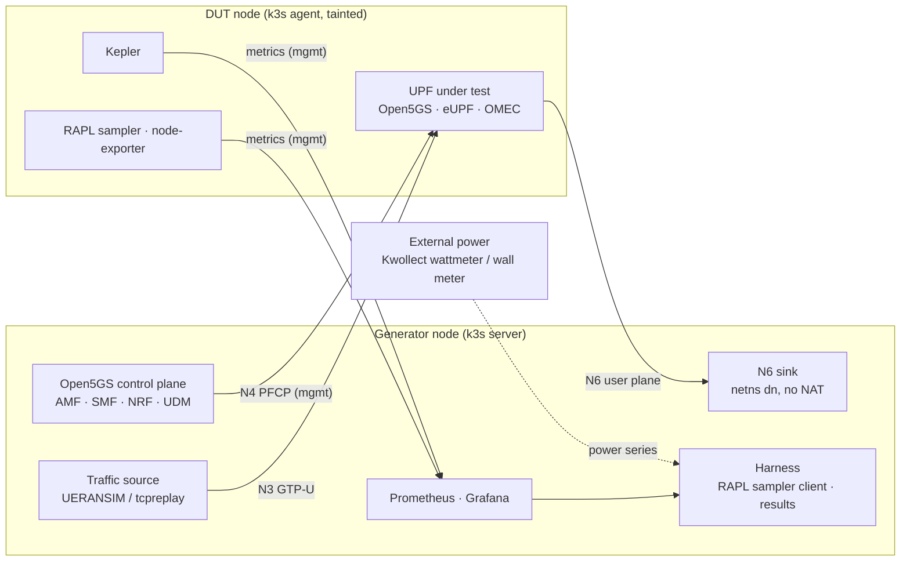

# watts-per-gigabit

**An open, reproducible method to measure joules per gigabit of open-source
5G user-plane functions (UPFs) on Kubernetes — validated against RAPL and
external power measurement, with Kepler's per-pod attribution as an object of
study.**

> **Status: scaffolding.** The repository currently contains the design
> documents, the methodological plan and an empty project structure. No
> deployable code or data yet. See [Status and roadmap](#status-and-roadmap).

---

## What this project is

Operators report energy savings in the 5G core with proprietary software, but
there is no open method to measure the same thing on Kubernetes. Public
comparisons of open-source UPFs report throughput and CPU, not energy, and
Kepler — the CNCF tool for per-pod energy attribution — has not been validated
on a telco data plane.

This project builds a two-node bench with real control/user-plane separation,
runs three UPFs one at a time on identical hardware under controlled load, and
measures the incremental power they cost. What matters is the **comparison
between UPFs on the same hardware** and the **validation of the measurement
chain** — not absolute watts.

### Working hypotheses

Inferred from the design document; refined after integration.

| ID | Hypothesis |
| --- | --- |
| H1 | UPFs differ markedly in idle and low-load power; busy-polling data planes sit close to their full-load power at 0 % load. |
| H2 | Energy per bit falls with load and packet size for every UPF, but the ranking between UPFs changes across the load range and packet sizes. |
| H3 | Kepler's per-pod attribution deviates substantially from RAPL ΔP for data-plane pods because it apportions by CPU time. |
| H4 | Kernel-level CPU settings (governor, C-states, core count) shift ΔP by an amount comparable to the gap between UPFs, at a measurable p99 latency cost. |

### UPFs under test

| UPF | Data-plane technology |
| --- | --- |
| [Open5GS UPF](https://open5gs.org/) | Linux kernel GTP-U |
| [eUPF](https://github.com/edgecomllc/eupf) | eBPF / XDP |
| [OMEC / SD-Core UPF](https://github.com/omec-project/upf) | DPDK busy-polling (and AF_PACKET) |

## Testbed platforms

| Platform | Role | External power |
| --- | --- | --- |
| [Grid'5000](https://www.grid5000.fr/) | **Primary** — calibration and every published measurement ([ADR-11](docs/adr/0011-grid5000-as-primary-measurement-platform.md)); wattmeter-equipped nodes, N3/N6 sharing the second NIC | Dedicated wattmeter via Kwollect (`wattmetre_power_watt`, 1 s) |
| Home bench (laptop + mini PC with 3 × Intel I226) | **Secondary** — development, calibration between reservations, consumer-hardware cross-check ([ADR-02](docs/adr/0002-dedicated-mini-pc-as-dut.md)) | Smart plug, ≥ 1 Hz |



Source: [`docs/figures/architecture.mmd`](docs/figures/architecture.mmd).
Full description: [`docs/architecture.md`](docs/architecture.md).

## Measurement method

- **Reference:** RAPL package energy, read by the project's own 1 Hz sampler
  with counter-wrap handling, validated against `perf` within 1 %.
- **Validation:** external node power (Grid'5000 wattmeter through Kwollect,
  or a wall meter at home) covering NIC, memory and board that RAPL does not
  see.
- **Object of study:** Kepler. Its node total must match RAPL; its per-pod
  apportionment is compared with RAPL ΔP.
- **Method:** ETSI ES 203 539 laboratory method — power under load minus
  power without the VNF (ΔP), per load level, with an SLA check at each
  level. Efficiency also reported as 3GPP TS 28.554 bit/J. Isolation,
  duration and reporting rules from IETF RFC 8172 and RFC 2544.
- **Protocol:** randomized order, 2 min warm-up, 5 min steady window, ≥ 3
  repetitions, same-day baseline, chrony offset < 10 ms, full run manifest.

### Metrics

ETSI per-level efficiency, weighted (weights 0.2 / 0.5 / 0.3 for 10 / 50 /
100 % load, from the standard's Annex A, declared as an assumption):

$$
\mathrm{EER}_{\mathrm{UPF}} =
  \sum_{i=1}^{N} w_i \cdot \frac{U_i}{P_{i,\mathrm{load}} - P_{\mathrm{idle}}}
  \quad [\mathrm{bit/J}]
$$

3GPP 5GC energy efficiency, computed over the UPF node's energy (control plane
excluded by construction):

$$
\mathrm{EE}_{\mathrm{5GC}} =
  \frac{8 \cdot (\mathrm{oct}_{N3,UL} + \mathrm{oct}_{N3,DL})}{E_{\mathrm{UPF\ node}}}
  \quad [\mathrm{bit/J}]
$$

Also reported: ΔP (W), energy per gigabit (J/Gbit), energy proportionality and
Kepler attribution error. All derived metrics are computed in `analysis/` from
raw data; none are stored.

## Repository layout

```text
watts-per-gigabit/
├── Makefile            # bench-up, bench-down, smoke, run-point, campaign (stubs)
├── ansible/
│   ├── inventory/      # *.example.yml for home, lab and grid5000 (real ones git-ignored)
│   └── roles/          # host-tuning, k3s-server, k3s-agent, netns-dn, chrony
├── k8s/
│   ├── monitoring/     # kube-prometheus-stack and Kepler values
│   ├── core/           # Open5GS control plane values and subscribers
│   └── upf/            # open5gs/, eupf/, omec/ with the same values contract
├── harness/            # Python harness, pcap generator, samplers
├── data/               # runs/, results.csv, data dictionary (CC BY 4.0)
├── analysis/           # notebooks and figures
├── docs/               # methodology, requirements, architecture, test plan, adr/, logbook/
├── CITATION.cff
├── LICENSE             # Apache-2.0
└── SECURITY.md
```

Each directory has a README stating its intent and status.

## Quick start

Nothing runs yet. The planned entry points are:

```sh
make                      # list targets
make bench-up INV=ansible/inventory/grid5000.yml   # provision both nodes, k3s, monitoring
make smoke UPF=eupf       # deploy one UPF, run functional checks
make run-point UPF=eupf LOAD=50 PKT=1400 REP=1     # one measurement point
make campaign             # full randomized matrix
```

Today every target prints `not implemented yet` and exits non-zero.

## Status and roadmap

| Gate | Meaning | Status |
| --- | --- | --- |
| G1 | Design review: no open decision changes the platform; Grid'5000 acceptance reservation passed | Pending (Nov 2026) |
| G2 | Stable idle baseline (< 5 % variation) on the primary platform | Pending |
| G3 | Two UPFs carrying traffic, one busy-polling and one kernel/eBPF | Pending |

Stages 0–1 (initiation, design) are documented; the next step is a short
Grid'5000 acceptance reservation that validates the design before G1, then
stage 2 (bench as code, calibration). Full plan:
[`docs/methodology.md`](docs/methodology.md).

## Reproducibility and data policy

Every run produces a manifest, a 1 Hz time series and one summary row; the
harness refuses to write a result without a complete manifest. Raw data are
never edited. Data schema and licensing: [`data/README.md`](data/README.md).
Raw runs are published as a tagged, Zenodo-archived release.

This repository is public. Testbed credentials and real inventories are never
committed; see [`SECURITY.md`](SECURITY.md).

## Standards and references

ETSI ES 203 539 · 3GPP TS 28.554 (6.7.4.2, 6.7.3.1.4) · IETF RFC 8172 ·
IETF RFC 2544 · Nygard, *Documenting Architecture Decisions*. Full list in
[`docs/methodology.md`](docs/methodology.md), section 10.

## License

Code is licensed under [Apache-2.0](LICENSE). Data under `data/` is released
under [CC BY 4.0](https://creativecommons.org/licenses/by/4.0/).

## Academic context

This work is developed as part of graduate research in collaboration with
Télécom Paris.

## Acknowledgement

Experiments presented in this paper were carried out using Grid5000, one of
the precursor infrastructures of the SLICES-FR testbed, operated by a
scientific interest group including 14 major French academic institutes and
Universities (see <https://slices-fr.eu/>).

## How to cite

See [`CITATION.cff`](CITATION.cff). A Zenodo DOI will be assigned at the
first tagged release.
